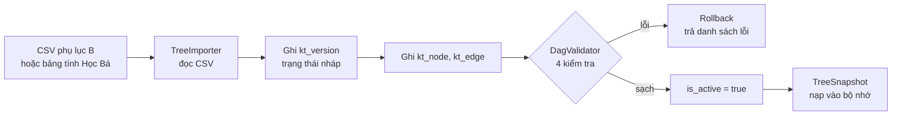
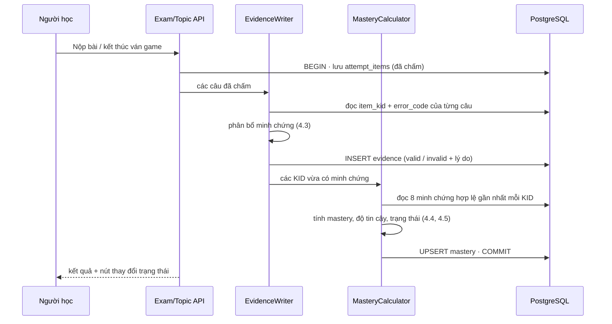
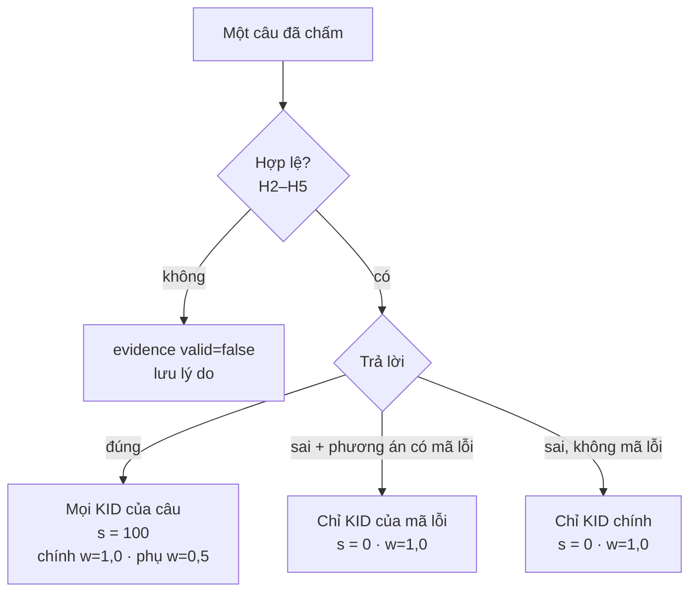
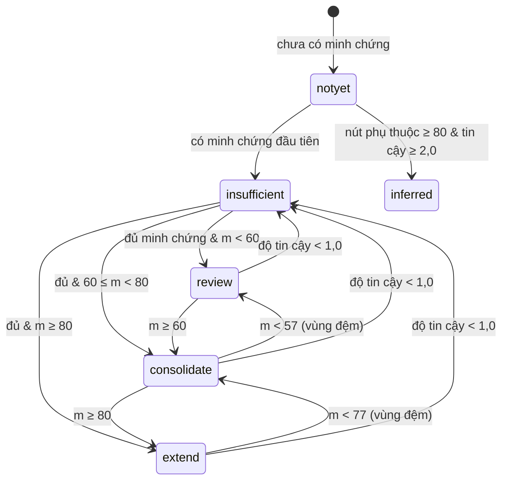
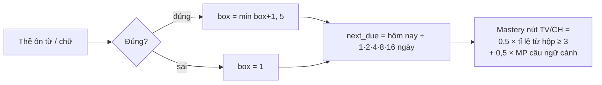
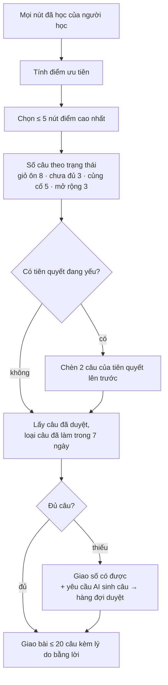
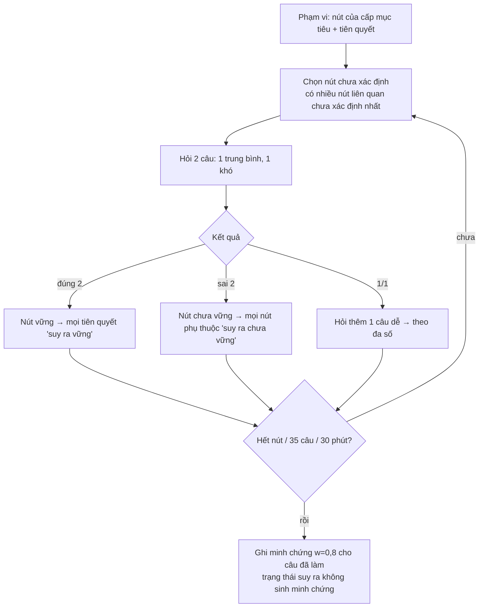

# Cây tri thức CNHSK — logic hướng làm, công nghệ, luồng xử lý

> Brainstorm · 18/10/2026 · plan [`261017-1654-cay-nang-luc-han-ngu`](../plan.md)
> Nguồn: `Cay-Nang-Luc-Han-Ngu_HSK1-9_Dac-ta-v2.0.pdf` (ch. 3, 5, 9, phụ lục B, F, J) · bản giải thích [`giai-thich-cay-nang-luc.md`](../../../docs/reference/cay-nang-luc/giai-thich-cay-nang-luc.md)
> Chế độ: markdown + artifact HTML

---

## 0 · Giả định đang dùng

Phase 1 chưa chốt. Tài liệu này dựng theo **khuyến nghị** của phase 1. Đổi quyết định nào thì đổi phần tương ứng.

| # | Giả định | Phần bị ảnh hưởng nếu đổi |
|---|---|---|
| Q1 | Hướng **B**: áp phần lõi, bỏ phần LMS lớp học | Toàn bộ |
| Q2 | Tầng mục từ dùng **Leitner 5 hộp** | Mục 4.7 |
| Q3 | Lược đồ HSK 1–9, nạp **174 nút sơ cấp** | Mục 4.1 |
| Q4 | Bỏ cổng 90%, mở bài theo **biên học tập** | Mục 4.6 |
| Q5 | Nạp **phụ lục B** làm `KT-2026.0-draft` | Mục 4.1 |

---

## 1 · Bài toán trong một câu

Mỗi câu trả lời của người học phải biến thành **bằng chứng về đúng nút năng lực**, từ đó hệ thống
biết người học **vững nút nào, hổng nút nào, hổng vì nút gốc nào, và hôm nay nên ôn gì**.

Code hiện tại: các module `auth` `learning` `community` `shared` **mới là khung rỗng** (`.gitkeep`).
Không có code nào phải gỡ, chỉ có tài liệu và migration phải sửa. Đây là thời điểm rẻ nhất để đổi.

---

## 2 · Logic hướng làm — 7 nguyên tắc

| # | Nguyên tắc | Hệ quả kỹ thuật |
|---|---|---|
| 1 | **Cây là dữ liệu, không phải code.** Học Bá sở hữu nội dung cây | Cây nằm trong bảng `kt_*`, nạp từ CSV/bảng tính. Không hard-code KID trong Java |
| 2 | **CNHSK nhập cây, không biên soạn cây** | Không xây công cụ vẽ cây, quy trình duyệt nhiều bước. Chỉ có: nhập → kiểm tra DAG → kích hoạt phiên bản |
| 3 | **Minh chứng chỉ thêm, không sửa** | Bảng `evidence` append-only. Sai thì đánh `valid=false`, không xoá |
| 4 | **Mastery là hàm thuần của minh chứng** | `mastery = f(8 minh chứng gần nhất, policy, hôm nay)`. Bảng `mastery` chỉ là bộ đệm, tính lại được bất cứ lúc nào |
| 5 | **Cập nhật trong cùng transaction** | Lưu bài làm, ghi minh chứng, cập nhật mastery chung một transaction (giữ cam kết "chơi game xong mastery đổi ngay") |
| 6 | **Tham số có phiên bản** | Trọng số, ngưỡng, bán rã nằm trong `mp_policy.params` (JSONB), mọi bản ghi lưu `policy_version` |
| 7 | **"Chưa có dữ liệu" khác "yếu"** | Trạng thái `insufficient` riêng; không bao giờ báo yếu khi chưa đủ 3 minh chứng |

### Thứ tự dựng

```
① Dữ liệu cây  →  ② Nối nội dung  →  ③ Bộ tính mastery  →  ④ Gợi ý + chẩn đoán  →  ⑤ Màn hình
   kt_node          item_kid            evidence              Recommender             hồ sơ năng lực
   kt_edge          error_code          mastery               DiagnosticRunner        biên học tập
   DAG check        lexemes.node_kid    lexical_state                                 điểm yếu theo nút
```

Mỗi bước dùng được ngay đầu ra của bước trước. Không bước nào cần bước sau mới kiểm thử được.

---

## 3 · Công nghệ

### 3.1 · Đã có trong dự án — dùng tiếp

| Tầng | Công nghệ (pom.xml / application.yaml) | Dùng cho cây |
|---|---|---|
| Backend | Spring Boot **3.5.14**, Java **17** | Module `learning` chứa toàn bộ cây + mastery |
| Truy cập dữ liệu | Spring Data JPA, Hibernate `ddl-auto: validate` | Entity cho `kt_node`, `evidence`, `mastery`… |
| Migration | **Flyway** (schema `learning`, `auth`, `community`) | `V3__knowledge_tree` → `V5__mastery_engine` |
| CSDL | **PostgreSQL** | Recursive CTE kiểm tra DAG, JSONB cho tham số/ví dụ, partial unique index cho "1 KID chính" |
| Cache | Redis | **Không dùng cho cây** (xem 3.3). Giữ cho bảng xếp hạng, phiên |
| Bảo mật | Spring Security + JJWT | Endpoint `/api/me/*` lấy `user_id` từ JWT |
| Kiến trúc | **ArchUnit** (`ModuleBoundaryTest`) | Chặn `community.game` gọi thẳng repository mastery; phải qua `learning.api` |
| Test | JUnit 5, spring-boot-starter-test | Test MP-1.0 bằng ví dụ số của đặc tả |

### 3.2 · Cần thêm

| Thêm | Vì sao | Thay thế đã cân nhắc |
|---|---|---|
| **Testcontainers PostgreSQL** (`org.testcontainers:postgresql`) | Test hiện chạy **H2** — H2 không chạy được recursive CTE kiểu Postgres, JSONB, partial index → test DAG/ma trận Q trên H2 sẽ sai hoặc không chạy | Giữ H2: rẻ nhưng test không phản ánh thật |
| **Apache Commons CSV** | Nạp `kt-2026-0-draft-so-cap.csv`, mã lỗi, ánh xạ từ → nút | Viết tay parser: dễ lỗi với tên có dấu phẩy, chữ Hán |
| `@Scheduled` (có sẵn trong Spring) | Job đêm: cập nhật đến hạn ôn, hạ trạng thái khi độ tin cậy < 1,0 | Quartz: thừa |
| Node + `pdfjs-dist` (chỉ một lần, ngoài app) | Trích bảng phụ lục B từ PDF ra CSV | Gõ tay 174 nút: chậm, dễ sai |

### 3.3 · Không cần — và vì sao

| Không dùng | Lý do |
|---|---|
| CSDL đồ thị (Neo4j…) | Cây vài trăm nút, vài nghìn cạnh. Đặc tả mục 1.4 nói rõ PostgreSQL đủ |
| Redis cho cây | Cây bất biến theo phiên bản và nhỏ (< 1 MB). Giữ **trong bộ nhớ JVM** dạng `TreeSnapshot`, nạp lại khi đổi phiên bản. Nhanh hơn Redis, không phải lo đồng bộ |
| Kafka / RabbitMQ / Event Bus | CNHSK một tiến trình, mastery cập nhật cùng transaction. Event Bus là của LMS Học Bá |
| Thư viện ML (pyBKT, IRT) | Đặc tả mục 5.12: chỉ cân nhắc sau ~400 học viên, mỗi nút ≥ 2.000 lượt. Đồ án không đạt mức này |
| Thư viện vẽ đồ thị cho người học | Người học thấy cây dạng **danh sách theo miền**, không cần sơ đồ. Màn quản trị nếu cần sơ đồ thì dùng `@xyflow/react` ở V2 |

### 3.4 · Hai điểm lệch cấu hình phát hiện khi scout

| Vấn đề | Chi tiết | Cần làm |
|---|---|---|
| **Java 17 vs 21** | `pom.xml` đặt `java.version 17`; Report 2 ghi "Java 21 with Spring Boot" | Chốt một; sửa report hoặc pom |
| **Flyway không thấy migration** | Migration nằm ở `db/migration/` (gốc repo); Flyway mặc định đọc `classpath:db/migration` (`src/main/resources/db/migration`) | Chuyển thư mục, hoặc đặt `spring.flyway.locations: filesystem:db/migration` |

---

## 4 · Luồng logic

### 4.1 · Nạp cây (một lần mỗi phiên bản)



Bốn kiểm tra (phụ lục F.4): **vòng lặp** · **tiên quyết cấp cao hơn nút** · **cạnh bắc cầu thừa** · **> 4 tiên quyết trực tiếp**.
Chạy bằng Java (topological sort) khi nhập và bằng recursive CTE trong test để chắc DB cũng sạch.

### 4.2 · Từ câu trả lời đến mastery — luồng chính



### 4.3 · Phân bổ minh chứng — sai thì đổ lỗi cho nút nào



Hợp lệ khi: không bị cờ gian lận · không phải timeout/thiếu dữ liệu · **chưa làm đúng câu này trong 7 ngày** · câu hỏi còn ở trạng thái đã duyệt.

### 4.4 · Công thức MP-1.0 (giả mã)

```java
// MasteryCalculator — hàm thuần, không đọc giờ hệ thống bên trong (truyền today vào để test được)
MasteryResult compute(List<Evidence> validNewestFirst, Policy p, Instant today) {
    List<Evidence> window = takeWindow(validNewestFirst, 8, /*maxPractice*/ 3);
    double sumW = 0, sumWS = 0;
    for (Evidence e : window) {
        double days = Duration.between(e.occurredAt(), today).toHours() / 24.0;
        double r = Math.pow(0.5, days / p.halfLifeDays());          // 30 ngày ở sơ cấp
        double w = e.wStatic() * r;                                 // bối cảnh × dạng câu × vai trò × r(t)
        sumW += w; sumWS += w * e.score();
    }
    Double mastery = window.isEmpty() ? null : sumWS / sumW;        // 0–100
    return new MasteryResult(mastery, sumW /*độ tin cậy*/, window.size(), idsOf(window));
}
```

Kiểm thử bắt buộc (số lấy từ đặc tả tr. 33, 36):

| Ca | Đầu vào | Kỳ vọng |
|---|---|---|
| Quốc Bảo · NP3-004 | 5 minh chứng (0 · 50 · 100 · 100 phụ · 40) | **53,3** · độ tin cậy 2,41 · giỏ ôn |
| + thi giữa khoá 80 | thêm minh chứng w = 1,0 | **61,1** · củng cố |
| TV2-007 | 26/40 từ hộp ≥ 3 · MP câu ngữ cảnh 72 | **68,5** · củng cố |

### 4.5 · Máy trạng thái của một nút



"Đủ minh chứng" = ≥ 3 minh chứng hợp lệ, không cùng một ngày, độ tin cậy ≥ 1,0.
Hạn ôn: giỏ ôn 3 ngày · củng cố 7 · mở rộng 14.

### 4.6 · Biên học tập — thay cổng 90%

Một nút **sẵn sàng học** khi: chưa vững (`state ∉ {extend, inferred}`) **và** mọi tiên quyết trực tiếp ở `extend` hoặc `inferred`.

```sql
-- Biên học tập của một người học (cây đang active)
SELECT n.id, n.name_vi
FROM kt_node n
LEFT JOIN mastery m ON m.kid = n.id AND m.user_id = :uid AND m.tree_version = n.tree_version
WHERE n.tree_version = :v
  AND coalesce(m.state, 'notyet') NOT IN ('extend', 'inferred')
  AND NOT EXISTS (
    SELECT 1 FROM kt_edge e
    LEFT JOIN mastery pm ON pm.kid = e.from_id AND pm.user_id = :uid AND pm.tree_version = e.tree_version
    WHERE e.tree_version = :v AND e.to_id = n.id AND e.type = 'prereq'
      AND coalesce(pm.state, 'notyet') NOT IN ('extend', 'inferred'));
```

Chủ đề từ vựng (nút TV dạng tập mục) không có tiên quyết bắt buộc → luôn mở; thứ tự gợi ý theo cấp.

### 4.7 · Tầng mục từ (Leitner)



Flashcard **không** sinh minh chứng MP — chỉ đổi hộp. Câu ngữ cảnh (đọc hiểu có từ của nút) mới sinh minh chứng.

### 4.8 · Gợi ý ôn hằng ngày



Điểm ưu tiên (đặc tả mục 5.7):
`giỏ ôn: 100 + (60 − m)` · `chưa đủ: 55` · `củng cố đến hạn: 60 + (80 − m)` · `mở rộng đến hạn: 30` · `+20 nếu đến hạn` · `+15 × số nút phụ thuộc sắp học`.

### 4.9 · Bài chẩn đoán đầu vào



Suy luận chạy trên `TreeSnapshot` trong bộ nhớ (BFS ngược/xuôi theo cạnh `prereq`), không truy vấn DB mỗi bước.

### 4.10 · Job đêm (00:30 Asia/Ho_Chi_Minh)

1. Nút có `due_at ≤ now()` → đánh dấu đến hạn (dùng cho gợi ý).
2. Tính lại độ tin cậy với r(t) mới → nút nào < 1,0 thì về `insufficient`.
3. Từ/chữ có `next_due ≤ today` → vào danh sách ôn thẻ.

---

## 5 · Bố cục code (module `learning`)

```
com.cnhsk.learning
├── tree/          TreeImporter · DagValidator · TreeSnapshot (bộ nhớ) · KtNode/KtEdge entity
├── content/       ItemKid · ErrorCode — ma trận Q, mã lỗi (gắn khi duyệt câu)
├── mastery/       MasteryPolicy · EvidenceWriter · MasteryCalculator · StateMachine · NightlyJob
├── srs/ → lexical/ LexicalScheduler (Leitner) · gộp lên nút TV/CH
├── recommend/     Recommender (điểm ưu tiên, chọn câu, lý do)
├── diagnostic/    DiagnosticRunner (chọn nút, suy luận DAG)
└── api/           LearningApi — cổng duy nhất cho community.game ghi kết quả (ArchUnit kiểm)
```

### API cho client

| Method · Path | Trả về |
|---|---|
| `GET /api/tree` | Nút + cạnh của phiên bản active (client cache theo `tree_version`) |
| `GET /api/me/mastery?domain=NP` | Hồ sơ năng lực theo miền: số nút theo trạng thái + danh sách nút |
| `GET /api/me/mastery/{kid}/evidence` | Các minh chứng tạo ra con số (nút "xem minh chứng") |
| `GET /api/me/frontier` | Biên học tập |
| `GET /api/me/recommendations/today` | ≤ 5 nút, ≤ 20 câu, lý do |
| `POST /api/diagnostics` · `POST /api/diagnostics/{id}/answers` | Bắt đầu chẩn đoán · nộp từng câu, nhận câu tiếp theo |
| `POST /api/admin/tree/import` | Nhập CSV → kiểm tra DAG → báo lỗi hoặc kích hoạt |

---

## 6 · Hai lựa chọn kỹ thuật đã cân nhắc

| Câu hỏi | Lựa chọn A | Lựa chọn B | Chọn |
|---|---|---|---|
| Tính mastery khi nào | **Khi ghi** (cùng transaction), lưu vào `mastery` | Khi đọc, tính từ `evidence` mỗi request | **A** — đọc nhiều hơn ghi; vẫn giữ hàm tính lại để kiểm toán |
| Cây nằm ở đâu lúc chạy | DB + **snapshot trong bộ nhớ** | Chỉ DB, truy vấn mỗi lần | **A** — chẩn đoán và gợi ý duyệt cạnh liên tục; cây nhỏ, bất biến theo phiên bản |
| Mục từ lưu ở đâu | Thêm 3 cột vào `lexemes` | Bảng `lexical_item` mới như phụ lục F | **A** — `lexemes` đã có chữ, pinyin, âm Hán Việt, nghĩa (DRY) |

---

## 7 · Rủi ro

| Rủi ro | Mức | Giảm thiểu |
|---|---|---|
| Thiếu câu hỏi: 174 nút × ≥ 5 câu = **≥ 870 câu đã duyệt** chỉ cho sơ cấp | Cao | Báo cáo độ phủ theo nút; dùng luồng AI sinh + giáo viên duyệt (BF-06) cho nút thiếu |
| Gắn sai KID làm sai mastery mọi người làm câu đó | Cao | Giáo viên xác nhận KID khi duyệt; theo dõi câu có tỉ lệ đúng lệch hẳn so với nút |
| Phụ lục B chưa có can_do, ví dụ, mã từ W/Z | TB | Cột nullable ở bản nháp; thay khi Học Bá giao bản chính thức |
| Test trên H2 cho kết quả sai | TB | Testcontainers PostgreSQL cho test cây và mastery |
| Bảng `evidence` lớn dần | Thấp | Index `(user_id, kid, occurred_at DESC) WHERE valid`; chỉ đọc 8 dòng |
| Report/slide đã nói FSRS | TB | Phase 6; giải thích là căn chỉnh theo đặc tả Học Bá 16/10 |

---

## 8 · Tiêu chí thành công

- [ ] Nạp 174 nút, 4 kiểm tra DAG trả 0 lỗi
- [ ] Test số khớp đặc tả: 53,3 · 61,1 · 68,5
- [ ] Người học mới: không nút nào ở `review`
- [ ] Sai câu có mã lỗi chỉ trừ đúng KID của mã lỗi
- [ ] Ghi bài làm → mastery đổi trong cùng transaction, < 1 giây
- [ ] Chẩn đoán ~60 nút xong trong ≤ 35 câu
- [ ] `GET /api/me/mastery/{kid}/evidence` cho ra đúng các minh chứng tạo nên con số

## 9 · Bước tiếp theo

1. Chốt 6 quyết định phase 1 (đặc biệt Q2 Leitner/FSRS, Q5 nguồn cây — cần Học Bá).
2. Sửa 2 lệch cấu hình: Java 17/21, vị trí migration Flyway.
3. Thêm Testcontainers + Commons CSV vào `pom.xml`.
4. Làm phase 2 (nạp cây + DAG) — bước rẻ nhất, cho thấy cây chạy thật sớm nhất.

## Câu hỏi chưa giải quyết

1. Học Bá chấp nhận Leitner hay muốn FSRS cho tầng mục từ?
2. Có bảng tính cây chính thức và danh sách từ/chữ có mã W/Z trước tuần 6 không?
3. Java 17 hay 21 là chuẩn của nhóm?
4. Game có đủ "câu" rời để làm minh chứng (mỗi lượt đoán = một câu có KID), hay chỉ có điểm tổng của ván?
